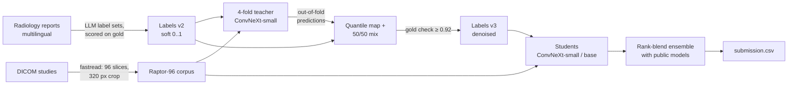

# Knee MRI Abnormality Detection (RSNA 2026, Kaggle)

Multi-label detection of 12 knee abnormalities from raw MRI studies. Most training labels are weak: they are extracted from free-text radiology reports.
Built for the Kaggle competition [RSNA Knee Abnormality Detection](https://www.kaggle.com/competitions/rsna-knee-abnormality-detection), which had 5,957 teams. Submissions are scored by macro ROC-AUC over the 12 findings, and inference must run offline on a T4 GPU within 9 hours.

> **Status (2026-10-15):** public leaderboard **0.956** macro AUC; the top of the board is 0.966. Students trained on the denoised labels are running now. The final private-leaderboard result will be added after the 22 October 2026 deadline.

## Highlights

- **Teacher → student label denoising.** The report-derived labels disagree with the gold image reads in a systematic way: reports miss many effusions, contusions and fractures that a reader sees on the images. I built a pipeline to correct for this:
  1. Train a 4-fold teacher.
  2. Use its out-of-fold predictions on the 4,349 training studies.
  3. Map those predictions onto the label scale.
  4. Mix them 50/50 with the report labels.

  Agreement with the 58 gold studies rose from **0.903 to 0.927** macro AUC. Effusion went from .880 to .964 and fracture from .901 to .942. No gold study was ever used for training.
- **2.5D attention-MIL models.** Each study becomes a 96-slice volume. Groups of 3 adjacent slices form one RGB image. A ConvNeXt encodes every window, and a per-finding attention pooling decides which windows matter for each abnormality. These models reach **0.90–0.91** macro AUC on the held-out gold set.
- **Inference that fits the 9 h limit and degrades safely.** Five or more models run as separate stages. Each stage has its own deadline, and a failed study or a failed stage falls back to the remaining models instead of crashing the run. All models are combined by a per-finding percentile-rank blend with weights fixed before any run.
- **Training throughput on Kaggle T4s:**
  - torch.compile cut the step time by 19% (0.74 → 0.60 s/step, A/B-tested on the two GPUs of one session).
  - The epoch count adapts to a time budget.
  - Each run starts with a smoke test.
  - `nn.DataParallel` leaked host memory (+30 MB per step, killed after ~1.5 epochs) and was 2× slower than one T4, so I diagnosed it and switched to one process per GPU.
- **Rebuilt the original notebook.** It scored 0.58 AUC on 12 validation studies. Its regex labels were English-only and close to random, and its sagittal and coronal slices were unordered. The models now score 0.90+ on 58 held-out gold studies.

## The problem

| | |
|---|---|
| **Input** | One knee MRI study: about 5.5 DICOM series covering sagittal, coronal and axial planes, both fluid-sensitive and other sequences |
| **Output** | 12 probabilities: ACL tear, MCL tear, medial meniscus tear, lateral meniscus tear, medial / lateral / patellofemoral osteoarthritis, effusion, synovitis, Baker's cyst, bone contusion, fracture |
| **Training data** | 4,407 studies. 4,349 have only a free-text report, in Spanish, English, Dutch, Turkish and other languages. **58 have gold labels.** |
| **Test data** | About 1,300 hidden studies, images only, scored inside a 9 h offline Kaggle notebook |
| **Metric** | Macro ROC-AUC: the mean over the 12 findings of each finding's AUC |

## Approach



1. **Labels.** I scored the public LLM-extracted label sets against the gold studies and averaged the two best into labels v2, which scores 0.903. Then I denoised them with a teacher's out-of-fold predictions to get labels v3, which scores 0.927.
2. **Preprocessing.** The training studies are decoded with exactly the same reader as at test time: 96 slices in 5 plane/sequence slots, a 140 mm central crop at 320 px. This puts training and test inputs on the same footing.
3. **Model.** A ConvNeXt encodes each 3-slice window, a per-finding attention-MIL head pools the windows, and a linear classifier scores each finding. Training uses soft-label BCE, fp16, a cosine LR schedule, and SWA over the last 3 epochs.
4. **Ensemble.** Each model is converted to percentile ranks per finding. The base is 0.5 × the public R7 ConvNeXt + 0.5 × the public Raptor CoAtNets. My models are blended into that base at a fixed weight.

[MODEL_FLOW.md](MODEL_FLOW.md) explains every step in detail. [DECISIONS.md](DECISIONS.md) records why each choice was made.

## Results

**Held-out gold set (58 studies, never used for training or model selection):**

| Model / labels | Gold macro AUC |
|---|---|
| Original notebook (12-study validation, regex labels) | 0.579 |
| Report labels v2 (the labels themselves, scored as predictions) | 0.903 |
| ConvNeXt-small on labels v2 (16 epochs, SWA) | 0.9075 |
| ConvNeXt-base on labels v2 (12 epochs, SWA) | 0.9090 |
| 4-fold teacher, each fold on 75% of the data | 0.883–0.887 (fold mean 0.890) |
| **Labels v3** (0.5 · report + 0.5 · mapped teacher) | **0.927** |
| Students on labels v3 | _training, to be added_ |

For comparison, the public Raptor model's honest held-out score is 0.9054, as stated by its author.

**Public leaderboard:**

| Submission | Public LB |
|---|---|
| Reproduction of the best public blend (R7 + Raptor) | 0.956 |
| + my ConvNeXt-small inside the Raptor stage (25% / 33%) | 0.954 / 0.953 |
| + fracture ← contusion post-processing | 0.956 |
| My 3 ConvNeXts alone (labels v2) | 0.936 |
| Base + my 3 ConvNeXts at 15% | _pending_ |
| 2 students alone (denoised labels v3) | _pending_ |

## What I built and what I reused

Several of the strongest models in this field are public, and the final ensemble uses them. This table makes the attribution explicit.

| Component | Source |
|---|---|
| Notebook audit and rebuild (labels, slice ordering, MIL model, cross-fitted gold validation, caching) | Mine |
| Scoring of public label sets against gold; labels v2 | Mine (built from public label sets by stevenleehans, pilkwang, riadmohamed42 / JEV, flight0234) |
| Label-noise analysis and teacher → student denoising (labels v3) | Mine |
| ConvNeXt members, the trainer, fold / OOF logic, throughput work | Mine |
| Raptor-96 training corpus | Mine, using the public Raptor preprocessing code (dreaddevelopment / nartaa, CC0) |
| Integration of extra models after R7 with deadlines and fallbacks | Mine |
| Raptor CoAtNet models (384 and 224) and the attention-MIL head design | Public: dreaddevelopment, nartaa |
| R7 ConvNeXt-small pipeline | Public: heliosli |
| Base rank-blend notebook | Public: heliosli, evgendvorkin |

## Repository layout

```
kaggle_jobs/
  members-a/train_member.py   trainer for every ConvNeXt member, teacher fold and student
  build_train_kernel.py       packs train_member.py + a launcher into a Kaggle notebook
  teacher-a/launcher.py       4-fold teacher: compile A/B smoke test, then 2 folds per GPU
  make_targets.py             builds labels v3 from the teacher's out-of-fold predictions
  students-a/, students-b/    student launchers (labels v3)
  patch_957.py                adds my models + blend weights to the public inference notebook
  blend-c*/                   generated submission notebooks
  top-957/, top-blend/        private copies of the public base notebooks
rsna-knee-abnormality-detection-v2.ipynb   my rebuilt end-to-end notebook (earlier phase)
IMPROVEMENT_PLAN.md, OPTIMIZATION_REPORT.md   audit of the original notebook and its optimisation
Past Version/                 earlier notebook versions
```

Competition data, caches, checkpoints and Kaggle outputs (`data/`, `working/`) are not included. The competition rules don't allow redistributing the data.

## Reproducing

Everything trains on Kaggle. A local GPU is not needed. You need the Kaggle CLI (`pip install kaggle`) and an API token.

```bash
# 1. Teacher (one T4x2 session, ~2.3 h)
python -P kaggle_jobs/build_train_kernel.py kaggle_jobs/teacher-a rsna-knee-teacher-a "# teacher"
kaggle kernels push -p kaggle_jobs/teacher-a

# 2. Denoised labels (CPU, seconds); asserts the gold check before writing
kaggle kernels output <user>/rsna-knee-teacher-a -p teacher_out
python -P kaggle_jobs/make_targets.py teacher_out data/labels_v2/labels_v3_denoised.parquet
kaggle datasets version -p data/labels_v2 -m "labels v3"   # relative path

# 3. Students (one T4x2 session each)
python -P kaggle_jobs/build_train_kernel.py kaggle_jobs/students-a rsna-knee-students-a "# students"
kaggle kernels push -p kaggle_jobs/students-a

# 4. Submission notebook: base blend + students at 15%
python -P kaggle_jobs/patch_957.py kaggle_jobs/blend-c5 rsna-knee-c5 0.15 0 \
  --arm m_s3a_swa.pt=convnext_small.fb_in22k_ft_in1k_384 \
  --arm m_s3b_swa.pt=convnext_small.fb_in22k_ft_in1k_384 \
  --kernel <user>/rsna-knee-students-a
kaggle kernels push -p kaggle_jobs/blend-c5
```

## Tech stack

Python, PyTorch 2 (AMP, `torch.compile`, `channels_last`), timm (ConvNeXt, CoAtNet), scikit-learn (AUC, isotonic regression), pandas, pydicom, Kaggle API.

## Lessons learned

- **Labels beat architecture.** The biggest gains came from fixing labels and measuring them against gold, not from bigger backbones.
- **Measure what the labels are.** The gold labels turned out to be an independent image read rather than report-derived. That single fact explains why report labels plateau at about 0.90 and why denoising works.
- **A small gold set can't rank close models.** With 58 studies, seed noise is about ±0.006. A member scoring 0.9075 on gold still lowered the leaderboard score. I treat the gold set as a sanity check and the leaderboard as the judge.
- **Fix weights before looking at results.** All blend weights were chosen before each run. With 5 submissions a day, tuning to the public leaderboard would overfit it.

## Acknowledgements

RSNA and Kaggle for the competition and data. The public Raptor (dreaddevelopment, nartaa), R7 (heliosli) and blend (evgendvorkin, heliosli) notebooks. The public LLM label sets by stevenleehans, pilkwang, riadmohamed42 and flight0234. timm by Ross Wightman.
